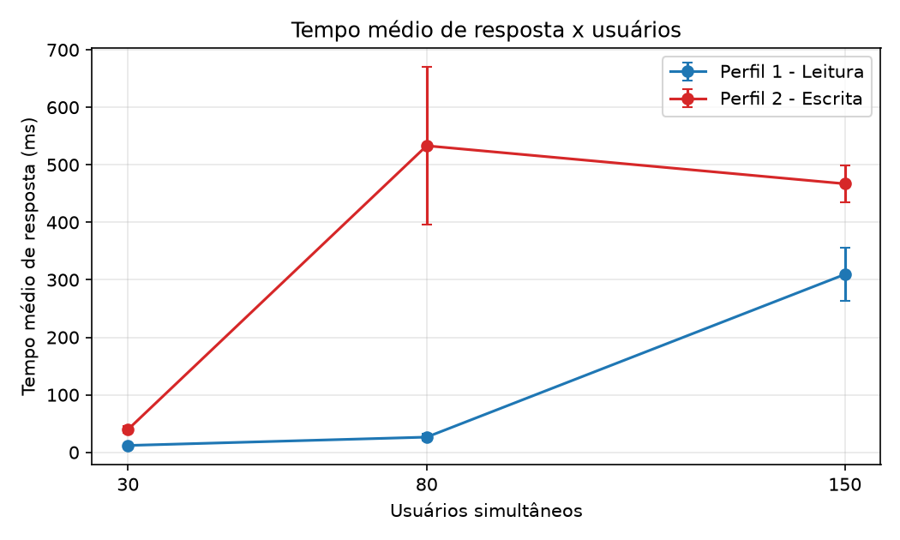
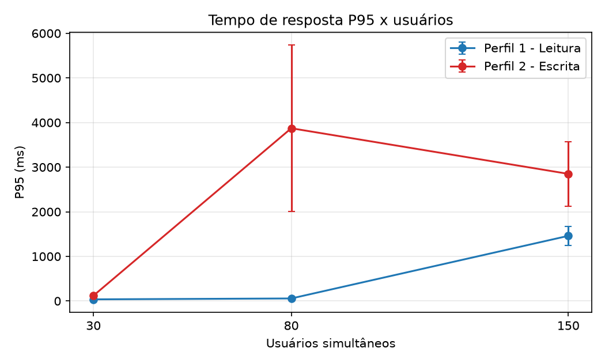
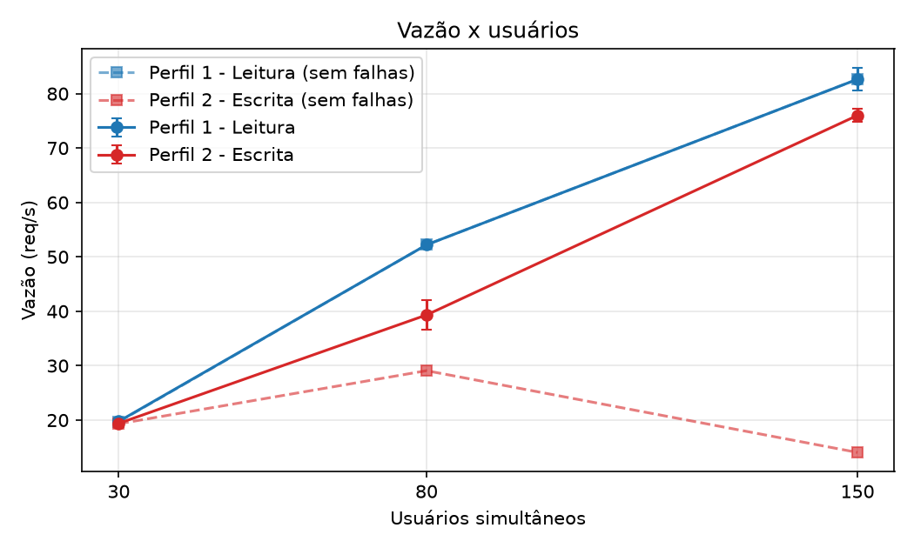
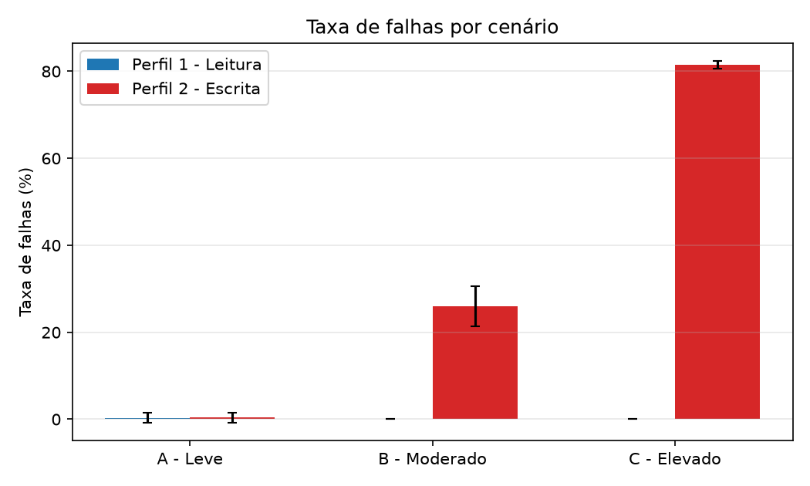
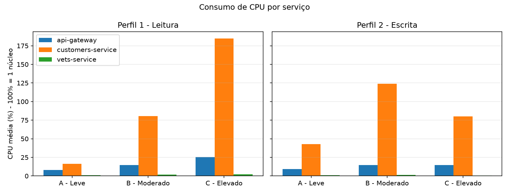
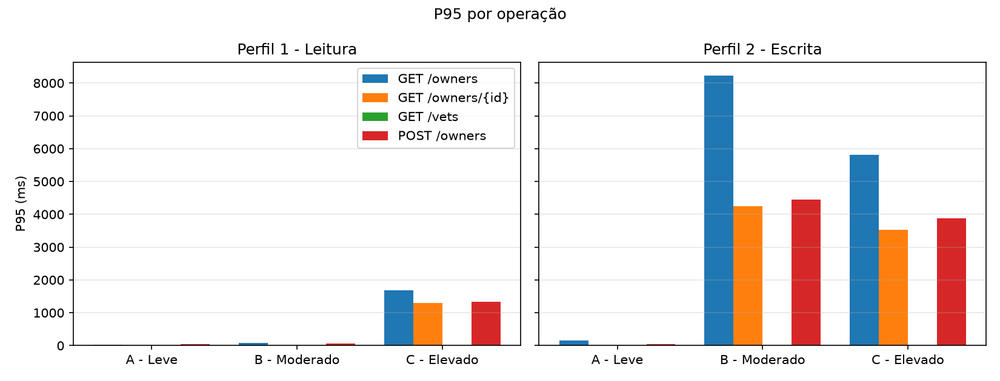
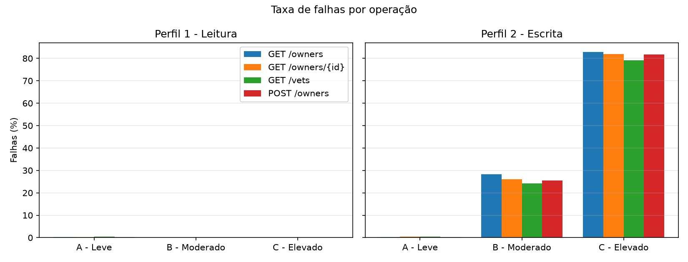
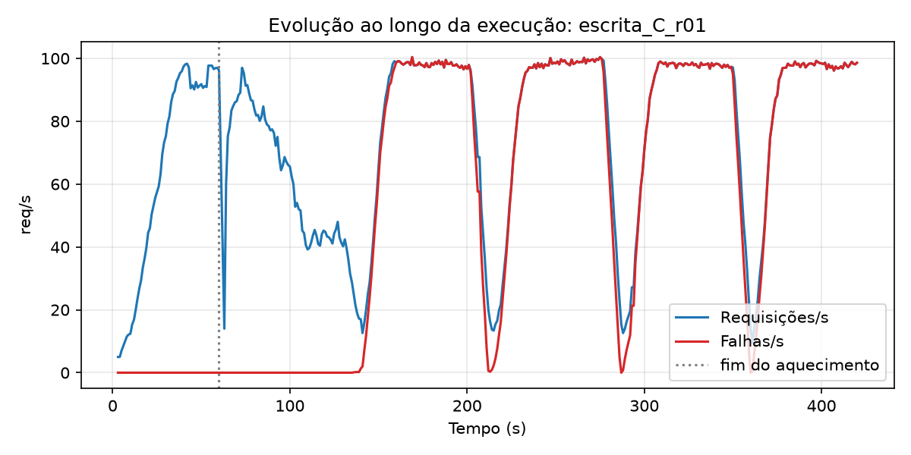

# TP06 — Avaliação de Desempenho de Microsserviços com Locust

**Aluno:** Lucas Araújo Moura · **Disciplina:** Sistemas Distribuídos · **Entrega:** 23/10/2026

**Vídeo demonstrativo (4 a 6 min):** `https://youtu.be/G-NqCF3iUcQ`

## 1. Objetivo

Avaliar o desempenho do [Spring PetClinic Microservices](https://github.com/spring-petclinic/spring-petclinic-microservices) com o Locust, analisando o impacto da quantidade de usuários e dos diferentes tipos de requisições.

O experimento combina **2 perfis de carga** (leitura e escrita) com **3 cenários** (30, 80 e 150 usuários) e **10 repetições** de cada configuração, totalizando **60 execuções** (cerca de 8 horas de testes, de 22/10/2026 19:45 a 23/10/2026 03:45).

## 2. Estrutura do repositório

```
.
├── locustfile.py                 # os dois perfis de carga (LeituraUser e EscritaUser)
├── requirements.txt              # dependências Python
├── scripts/
│   ├── run_experiments.py        # executa as 60 execuções (reset, Locust, coleta de CPU)
│   └── analyze_results.py        # agrega as repetições, gera tabelas e gráficos
└── results/
    ├── raw/                      # CSVs do Locust, CPU por execução, logs e runs_log.csv
    ├── run_experiments.log       # saída do script durante as 60 execuções
    ├── runs_summary.csv          # uma linha por execução
    ├── summary_by_scenario.csv   # Tabela 1
    ├── summary_by_endpoint.csv   # Tabela 2
    ├── summary_cpu.csv           # Tabela 3
    ├── tables.md                 # as três tabelas em Markdown
    └── charts/                   # gráficos (PNG)
```

## 3. Ambiente

| Item | Valor |
|---|---|
| Máquina | Notebook, Windows 11, 8 GB de RAM, Intel Core i5-13420H (13ª geração), 12 processadores lógicos |
| Docker | Docker Desktop com WSL2, Docker 29.4.3 |
| Limites do WSL2 (`.wslconfig`) | 4 processadores, 4 GB de memória, 4 GB de swap (a VM do Docker enxerga cerca de 3,8 GiB) |
| Aplicação | spring-petclinic-microservices, commit `1d76b00` (29/08/2026), via Docker Compose com as imagens publicadas `springcommunity/*` (sem build local) |
| Serviços executados | config-server, discovery-server, customers-service, vets-service, api-gateway |
| Serviços não executados | visits-service, genai-service, admin-server, tracing-server, grafana-server, prometheus-server |
| Limite de memória | 512 MB por serviço (definido no `docker-compose.yml` do projeto) |
| Python / Locust | Python 3.13.2, Locust 2.47.0, pandas 3.1.0, matplotlib 3.11.2 |

**Por que só cinco serviços?** O trabalho testa apenas `/owners`, `/owners/{id}` e `/vets`, que dependem de customers-service e vets-service (mais config-server, discovery-server e api-gateway). Os demais foram omitidos para caber nos 8 GB de RAM do notebook. O genai-service ainda exigiria chave de API externa.

O Locust rodou **na mesma máquina** da aplicação, em modo headless, e os dois disputam recursos (ver limitações na seção 8).

### Endpoints (todos pelo API Gateway, `http://localhost:8080`)

| Operação | Caminho |
|---|---|
| GET /owners | `/api/customer/owners` |
| GET /owners/{id} | `/api/customer/owners/{id}` (ids de 1 a 10, que existem desde o início) |
| GET /vets | `/api/vet/vets` |
| POST /owners | `/api/customer/owners` (corpo JSON com dados aleatórios) |

Os caminhos foram verificados na instância usada, com `curl`, antes da escrita do `locustfile.py`.

## 4. Metodologia

**Perfis de carga** (`locustfile.py`, uma classe por perfil, escolhida na linha de comando):

| Operação | Perfil 1 — Leitura (`LeituraUser`) | Perfil 2 — Escrita (`EscritaUser`) |
|---|---|---|
| GET /owners | 45% | 20% |
| GET /owners/{id} | 35% | 20% |
| GET /vets | 15% | 20% |
| POST /owners | 5% | 40% |

Os percentuais são pesos de `@task` do Locust. Cada usuário espera de 1 a 2 s entre requisições (`wait_time = between(1, 2)`). Esse valor não é fixado pelo enunciado, foi escolhido por nós e define a vazão máxima possível (ver pergunta 2).

**Cenários:** A (30 usuários), B (80) e C (150), todos com 6 minutos de medição e 1 minuto de aquecimento, com entrada de 5 usuários por segundo (os 150 usuários estão ativos em 30 s, dentro do aquecimento).

**Aquecimento:** cada execução dura 7 min (`-t 420s`). Aos 60 s um listener do `locustfile.py` zera as estatísticas do Locust (`reset_all`), então os CSVs de resultado contêm apenas os 6 minutos medidos. A conferência é simples: na Leitura A, 7.083 requisições a 19,8 req/s correspondem a cerca de 358 s de medição. As amostras de CPU dos primeiros 65 s são descartadas na análise.

**Estado inicial igual em todas as execuções:** antes de cada uma, o script reinicia `customers-service` e `api-gateway` (o banco é em memória, então isso zera os dados criados pelos POSTs) e só começa quando o gateway responde 10 vezes seguidas com sucesso. O `vets-service` não é reiniciado.

**Ordem:** repetição 1 com os 6 cenários (leitura A, escrita A, leitura B, ...), depois repetição 2, e assim por diante, para que uma interrupção deixasse repetições completas.

**Validação das execuções:** uma execução com 90% ou mais de falhas seria considerada problema de ambiente e repetida (até 2 tentativas). Isso nunca ocorreu; a maior taxa observada foi 82,8%. O resultado de cada execução está em `results/raw/runs_log.csv`.

**Coleta de CPU:** durante cada execução, `docker stats --no-stream` é chamado em loop (amostra a cada cerca de 2 s) para `api-gateway`, `customers-service` e `vets-service`, e grava CPU e memória em `<execução>_cpu.csv`. O CPU% do Docker é relativo a um núcleo (100% = 1 núcleo; como o WSL2 está limitado a 4 processadores, o máximo é 400%).

**Métricas** (tomadas da linha `Aggregated` do CSV de cada execução e depois promediadas nas 10 repetições, com desvio padrão):

- *Tempo médio* e *P95* (ms): do Locust. O P95 da tabela é a média dos 10 P95 (um por execução).
- *Vazão* (req/s): `Requests/s` do Locust na janela medida, que inclui requisições com erro.
- *Vazão sem falhas*: `Requests/s − Failures/s`.
- *Total de requisições*: `Request Count` da janela medida.
- *Falhas (%)*: `Failure Count / Request Count`.

**Incidente durante a preparação:** num teste curto anterior ao experimento, reiniciar apenas o `customers-service` fez uma execução inteira falhar (100% de erros), e o gateway registrou `No servers available for service: customers-service`. Passamos a reiniciar também o gateway e a exigir 10 respostas seguidas com sucesso antes de iniciar; depois disso essa falha total logo no início da execução não se repetiu (nenhuma das 60 execuções foi invalidada). As falhas da escrita B e C são outro fenômeno, que aparece depois de cerca de 1 min de medição (seção 8).

## 5. Como reproduzir

Pré-requisitos: Windows, Git, Docker com pelo menos 4 GB de memória disponíveis e Python 3.11 ou superior. (Em Linux ou macOS, remova a linha `pywin32` do `requirements.txt` antes do `pip install` e ajuste os caminhos e a ativação do venv.)

```powershell
# 1. Aplicação (em outra pasta)
git clone https://github.com/spring-petclinic/spring-petclinic-microservices.git
cd spring-petclinic-microservices
docker compose up -d config-server discovery-server customers-service vets-service api-gateway
# aguarde 2 a 3 min e confira http://localhost:8761 (Eureka) e http://localhost:8080

# 2. Este repositório
git clone https://github.com/Lucasdesenvolv/tp06-petclinic-locust
cd tp06-petclinic-locust
python -m venv .venv
.\.venv\Scripts\Activate.ps1
pip install -r requirements.txt

# 3. Teste rápido de validação (cerca de 4 min, resultados separados em results\quick)
python scripts\run_experiments.py --reps 2 --scenarios A --warmup 10 --total 45 --outdir results\quick

# 4. Experimento completo (cerca de 8 h; pode ser interrompido e retomado)
python scripts\run_experiments.py

# 5. Análise (gera tabelas e gráficos em results\)
python scripts\analyze_results.py
```

O `run_experiments.py` grava um marcador `.done` por execução concluída, então rodar o mesmo comando de novo retoma de onde parou. Opções: `--reps`, `--scenarios`, `--profiles`, `--warmup`, `--total`, `--outdir`.

Execução manual de um perfil, sem o script:

```powershell
locust -f locustfile.py LeituraUser --headless -u 30 -r 5 -t 60s
```

Os avisos de `OPENAI_API_KEY` e `AZURE_OPENAI_*` no `docker compose` vêm do genai-service, que não é usado, e podem ser ignorados.

## 6. Resultados

Médias das 10 repetições (± desvio padrão). As tabelas completas estão em `results/tables.md` e os dados por execução em `results/runs_summary.csv`.

### Tabela 1 — Métricas por perfil e cenário

| Perfil | Cenário | Usuários | Reps | Tempo médio (ms) | P95 (ms) | Vazão (req/s) | Vazão sem falhas (req/s) | Total de req. | Falhas (%) |
|---|---|---|---|---|---|---|---|---|---|
| leitura | A - Leve | 30 | 10 | 12,0 ± 0,7 | 37,2 ± 8,2 | 19,8 ± 0,1 | 19,7 ± 0,2 | 7083 | 0,3 ± 1,1 |
| leitura | B - Moderado | 80 | 10 | 26,4 ± 6,6 | 56,9 ± 15,2 | 52,2 ± 0,3 | 52,2 ± 0,3 | 18734 | 0,0 ± 0,0 |
| leitura | C - Elevado | 150 | 10 | 309,4 ± 45,8 | 1460,0 ± 217,1 | 82,6 ± 2,1 | 82,6 ± 2,1 | 29650 | 0,0 ± 0,0 |
| escrita | A - Leve | 30 | 10 | 39,7 ± 5,9 | 119,8 ± 11,0 | 19,4 ± 0,1 | 19,3 ± 0,2 | 6954 | 0,4 ± 1,2 |
| escrita | B - Moderado | 80 | 10 | 533,1 ± 137,1 | 3872,0 ± 1866,0 | 39,3 ± 2,7 | 29,1 ± 2,4 | 14105 | 26,0 ± 4,6 |
| escrita | C - Elevado | 150 | 10 | 467,0 ± 32,4 | 2850,0 ± 724,6 | 76,0 ± 1,2 | 14,1 ± 0,6 | 27294 | 81,5 ± 0,8 |

> **Cuidado ao ler os tempos da escrita B e C.** O tempo médio e o P95 misturam respostas de sucesso com respostas de erro devolvidas em poucos milissegundos. Por isso o tempo médio da escrita C (467 ms) é menor que o da B (533 ms) mesmo com muito mais falhas. Esses tempos não são comparáveis aos da leitura.

### Tabela 2 — Métricas por operação (média das repetições)

| Perfil | Cenário | Operação | Tempo médio (ms) | P95 (ms) | Falhas (%) | Req. (média) |
|---|---|---|---|---|---|---|
| leitura | A | GET /owners | 15,6 | 23,8 | 0,3 | 3181,3 |
| leitura | A | GET /owners/{id} | 5,1 | 7,3 | 0,3 | 2487,4 |
| leitura | A | GET /vets | 5,3 | 7,9 | 0,4 | 1074,0 |
| leitura | A | POST /owners | 48,7 | 53,0 | 0,3 | 340,2 |
| leitura | B | GET /owners | 43,3 | 72,9 | 0,0 | 8455,8 |
| leitura | B | GET /owners/{id} | 10,3 | 9,9 | 0,0 | 6542,8 |
| leitura | B | GET /vets | 5,0 | 8,5 | 0,0 | 2797,0 |
| leitura | B | POST /owners | 50,8 | 55,3 | 0,0 | 938,6 |
| leitura | C | GET /owners | 434,9 | 1680,0 | 0,0 | 13293,1 |
| leitura | C | GET /owners/{id} | 278,3 | 1290,0 | 0,0 | 10365,8 |
| leitura | C | GET /vets | 7,1 | 10,9 | 0,0 | 4486,2 |
| leitura | C | POST /owners | 317,4 | 1330,0 | 0,0 | 1504,6 |
| escrita | A | GET /owners | 95,1 | 161,0 | 0,3 | 1407,2 |
| escrita | A | GET /owners/{id} | 8,8 | 9,1 | 0,4 | 1414,2 |
| escrita | A | GET /vets | 5,3 | 8,0 | 0,4 | 1387,5 |
| escrita | A | POST /owners | 44,5 | 52,8 | 0,3 | 2745,3 |
| escrita | B | GET /owners | 973,7 | 8230,0 | 28,3 | 2827,1 |
| escrita | B | GET /owners/{id} | 550,1 | 4248,5 | 26,1 | 2819,9 |
| escrita | B | GET /vets | 5,6 | 10,1 | 24,2 | 2832,1 |
| escrita | B | POST /owners | 568,0 | 4442,0 | 25,6 | 5625,5 |
| escrita | C | GET /owners | 697,7 | 5820,0 | 82,9 | 5468,3 |
| escrita | C | GET /owners/{id} | 507,2 | 3520,0 | 81,9 | 5477,1 |
| escrita | C | GET /vets | 4,0 | 7,9 | 79,1 | 5454,0 |
| escrita | C | POST /owners | 562,8 | 3880,0 | 81,8 | 10895,1 |

### Tabela 3 — CPU e memória por serviço (média das repetições)

| Perfil | Cenário | Serviço | CPU média (%) | CPU máx. média (%) | Memória média (MiB) |
|---|---|---|---|---|---|
| leitura | A | api-gateway | 7,9 | 64,2 | 338,1 |
| leitura | A | customers-service | 16,3 | 58,7 | 379,2 |
| leitura | A | vets-service | 1,0 | 31,7 | 343,5 |
| leitura | B | api-gateway | 14,7 | 62,2 | 349,8 |
| leitura | B | customers-service | 80,4 | 186,3 | 404,3 |
| leitura | B | vets-service | 1,7 | 24,4 | 343,9 |
| leitura | C | api-gateway | 25,6 | 115,5 | 357,8 |
| leitura | C | customers-service | 184,9 | 273,6 | 427,1 |
| leitura | C | vets-service | 2,3 | 45,4 | 344,5 |
| escrita | A | api-gateway | 9,1 | 49,6 | 349,2 |
| escrita | A | customers-service | 43,0 | 140,4 | 405,2 |
| escrita | A | vets-service | 1,0 | 19,5 | 343,5 |
| escrita | B | api-gateway | 14,8 | 71,2 | 356,5 |
| escrita | B | customers-service | 123,8 | 243,1 | 426,1 |
| escrita | B | vets-service | 1,3 | 24,7 | 344,2 |
| escrita | C | api-gateway | 14,6 | 110,7 | 369,4 |
| escrita | C | customers-service | 79,9 | 241,1 | 449,5 |
| escrita | C | vets-service | 0,7 | 13,2 | 344,8 |

### Gráficos

| | |
|---|---|
|  |  |
|  |  |
|  |  |
|  |  |

Também em `results/charts/`: `timeline_escrita_B_r01.png`.

## 7. Respostas às questões

**1. Como o aumento de usuários afeta o tempo de resposta?**
Cresce com a carga, e de forma não linear. No perfil de leitura, o tempo médio vai de 12,0 ms (30 usuários) para 26,4 ms (80) e para 309,4 ms (150). O P95 sai de 37,2 ms para 56,9 ms e depois para 1.460 ms. Entre 30 e 80 usuários a média dobra (cerca de 2,2×), mas entre 80 e 150 ela multiplica por cerca de 12×, o que sugere um ponto de saturação nesse intervalo. No perfil de escrita a degradação vem mais cedo: a média passa de 39,7 ms (A) para 533,1 ms (B), cerca de 13×, e o P95 de 119,8 ms para 3.872 ms. Na escrita C a média (467 ms) e o P95 (2.850 ms) ficam abaixo dos de B, mas isso não é melhora: 81,5% das requisições falharam, e as respostas de erro curtas puxam os números para baixo (ver seção 8).

**2. Qual perfil apresenta maior vazão?**
O de leitura. Com 30 usuários os dois são iguais (19,8 e 19,4 req/s), porque nesse cenário a vazão é limitada pelo tempo de espera dos usuários, não pelo sistema: com espera média de 1,5 s, cada usuário gera no máximo cerca de 0,67 req/s, o que dá em torno de 20, 53 e 100 req/s para 30, 80 e 150 usuários (estimativa teórica). A leitura acompanha isso em A e B (19,8 e 52,2 req/s) e chega a 82,6 req/s em C, abaixo dos 100 teóricos, sinal de saturação. A escrita entrega 39,3 req/s em B e 76,0 req/s em C, mas só **29,1** e **14,1 req/s** são respostas sem erro. Na vazão sem falhas, a leitura é cerca de 1,8× maior em B e cerca de 5,9× maior em C. A vazão total da escrita C é inflada pelas respostas de erro rápidas, então a comparação justa é a vazão sem falhas.

**3. Quais operações apresentam maior degradação?**
As operações do `customers-service`. Na leitura, de A para C o tempo médio de `GET /owners/{id}` vai de 5,1 para 278,3 ms (cerca de 55×), o de `GET /owners` de 15,6 para 434,9 ms (cerca de 28×) e o de `POST /owners` de 48,7 para 317,4 ms (cerca de 6,5×). `GET /vets` praticamente não degrada (5,3 para 7,1 ms, cerca de 1,3×), e seu serviço usa só 1 a 2% de CPU. Na escrita, `GET /owners` chega a 973,7 ms de média e 8.230 ms de P95 no cenário B, e `GET /owners/{id}` sobe de 8,8 para 550,1 ms (cerca de 62×). Uma observação a verificar: `GET /owners` já custa 95,1 ms na escrita A, contra 15,6 ms na leitura A com os mesmos 30 usuários. Isso é compatível com a lista de owners crescer a cada POST (a resposta fica maior), mas não medimos o tamanho das respostas para confirmar.

**4. Como o consumo de CPU varia entre os cenários?**
O `customers-service` é o serviço mais exigido. Na leitura, sua CPU média vai de 16,3% (A) para 80,4% (B) e 184,9% (C), com máximos médios de até 273,6%, ou seja, quase três núcleos em uso. O `api-gateway` passa de 7,9% para 14,7% e 25,6%, e o `vets-service` fica entre 1,0% e 2,3% em todos os cenários. Na escrita, a CPU do customers vai de 43,0% (A) para 123,8% (B) e **cai** para 79,9% (C). A queda é coerente com o que vimos na evolução de uma execução (seção 8): em C, boa parte das requisições deixa de chegar ao serviço. A memória do customers-service fica entre 379 e 450 MiB (limite de 512), com o maior valor na escrita C (449,5 MiB, cerca de 88% do limite). O CPU% é relativo a um núcleo, e o WSL2 foi limitado a 4.

**5. Qual cenário apresenta maior taxa de falhas?**
A **escrita C (150 usuários): 81,5 ± 0,8%**, seguida da escrita B (80 usuários): 26,0 ± 4,6%. A leitura fica em 0,0% em B e C. Nos cenários A a média é de 0,3 a 0,4%, mas vem de duas execuções isoladas (`leitura_A_r03` com 3,5% e `escrita_A_r04` com 3,7%), cuja causa não foi investigada. Nas execuções de escrita B e C, os GETs recebem erro HTTP 405 e o POST recebe erro 503.

## 8. Análise das falhas e limitações

### O que foi observado nas falhas da escrita

- **Todas as operações falham quase na mesma proporção**, inclusive `GET /vets` (24,2% em B e 79,1% em C), embora o `vets-service` não receba escrita e estivesse com CPU de 0,7 a 1,3%. Os erros não parecem vir de um serviço específico.
- **A maioria dos erros é devolvida rapidamente.** No `escrita_C_r10`, a mediana dos três GETs ficou em 3 ms (a do POST, em 46 ms). Em compensação, uma parte das requisições demora vários segundos: nessa mesma execução o P98 dos GETs e do POST chega a cerca de 10 s.
- **Os erros são do tipo 405 nos GETs e 503 no POST** (relatório de erros do Locust em `escrita_B_r10` e `escrita_C_r10`).
- **Não houve falta de memória nem reinício:** `OOMKilled=false` e `Restarts=0` para `customers-service` e `api-gateway`. A busca por "Connection refused", "timed out" e "Connection reset" no log do gateway só encontrou linhas da inicialização do container (Config Server e Zipkin, este último não executado nesse experimento).
- **A falha aparece depois de um período sem erros.** Evolução do `escrita_C_r10`, em janelas de 30 s desde o início da execução (os primeiros 60 s são aquecimento):

| Janela (s) | Falhas (%) | CPU gateway (%) | CPU customers (%) | CPU vets (%) |
|---|---|---|---|---|
| 0 | 0,0 | 37 | 68 | 2 |
| 30 | 0,0 | 45 | 136 | 9 |
| 60 | 0,0 | 38 | 203 | 3 |
| 90 | 0,0 | 22 | 192 | 2 |
| 120 | 35,9 | 20 | 137 | 0 |
| 150 | 100,0 | 14 | 0 | 0 |
| 180 | 94,2 | 12 | 61 | 0 |
| 210 | 90,9 | 10 | 107 | 0 |
| 240 | 100,0 | 13 | 0 | 0 |
| 270 | 86,8 | 9 | 114 | 3 |
| 300 | 100,0 | 11 | 21 | 0 |
| 330 | 96,3 | 9 | 47 | 0 |
| 360 | 95,8 | 13 | 80 | 0 |
| 390 | 100,0 | 10 | 0 | 0 |

Depois de cerca de 1 min com o customers-service em torno de 200% de CPU, as falhas começam e, a partir daí, o CPU dos serviços cai a zero em várias janelas mesmo com 150 usuários ativos: as requisições, inclusive as de `/vets`, deixam de chegar aos serviços. Essa tabela é de uma execução; as demais tiveram taxas médias parecidas (80,2% a 82,8% na escrita C), mas não examinamos a evolução de cada uma. O gráfico `timeline_escrita_C_r01.png` mostra a primeira.

### Hipóteses (não verificadas)

O comportamento é compatível com o API Gateway passando a rejeitar requisições, por exemplo por um circuit breaker com resposta de fallback, acionado pela lentidão do customers-service. **Não inspecionamos a configuração do gateway**, então isso é uma hipótese, não um resultado. Outra hipótese, também não verificada, é que a lista devolvida por `GET /owners` cresce a cada POST e torna as respostas mais pesadas ao longo da execução.

### Limitações

- **Locust e aplicação na mesma máquina**, com 8 GB de RAM e o WSL2 limitado a 4 processadores e 4 GB. O gerador de carga compete por recursos com os serviços, e os resultados valem para este ambiente, não para um servidor dedicado.
- **Limite de 512 MB por serviço** (padrão do compose) e **banco em memória**: a memória média dos serviços fica entre 66% e 88% do limite (o `customers-service` chega a 449,5 MiB na escrita C).
- **Aquecimento curto** (60 s) e reinício de `customers-service` e `api-gateway` antes de cada execução: cada execução começa com a JVM fria nesses dois serviços. O `vets-service` não era reiniciado, então começa já aquecido (a partir da segunda execução).
- **Tempo médio e P95 da escrita B e C** misturam sucessos e erros rápidos e não são comparáveis com os da leitura. O Locust não separa a latência apenas das respostas bem-sucedidas nos CSVs usados.
- **P95 médio:** o valor das tabelas é a média dos P95 de cada execução, não o P95 de todas as requisições juntas.
- **Think time escolhido por nós** (1 a 2 s), que define a carga efetiva; outros valores mudariam a vazão e o ponto de saturação.
- **GET /owners/{id}** usa apenas os ids de 1 a 10, que existem desde o início; os owners criados pelos POSTs não são consultados.
- **CPU amostrado a cada cerca de 2 s** com `docker stats`, e o corte do aquecimento (65 s) é aproximado.
- O tracing-server não foi executado, então o gateway registra avisos de spans descartados. Não parece relacionado às falhas, mas não foi descartado por medição.

## 9. Conclusões

1. **Leitura:** o sistema suporta bem 30 e 80 usuários (tempos de dezenas de ms, 0% de falhas). Com 150 usuários não há falhas, mas a latência sobe muito (P95 de 1,46 s) e o `customers-service` chega a quase três núcleos de CPU.
2. **Escrita:** é bem mais sensível. Já com 80 usuários há cerca de 26% de falhas, e com 150 usuários cerca de 81,5%, de modo que só 14,1 req/s de 76 req/s totais são respostas sem erro.
3. **O gargalo está no `customers-service`** (as operações de owners são as que degradam, e `/vets` não). Mas, nos cenários de escrita B e C, as falhas se espalham por todas as rotas, o que aponta para uma rejeição no nível do gateway, cuja causa exata não foi confirmada.
4. **Para trabalhos futuros:** inspecionar a configuração do gateway (circuit breaker e timeouts), medir o tamanho das respostas de `GET /owners` ao longo da execução, separar a latência de sucessos e de erros, e repetir o experimento com o gerador de carga em outra máquina.

## 10. Vídeo

`https://youtu.be/G-NqCF3iUcQ`: mostra a aplicação rodando (Eureka e telas), o `locustfile.py`, uma execução do Locust com o monitoramento de CPU (`docker stats`), os scripts de automação e os resultados (tabelas e gráficos).
